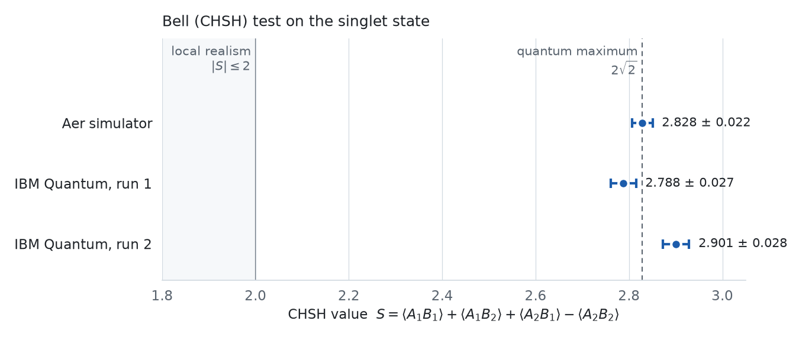

# Practical quantum computing with Qiskit

*Computación cuántica práctica con Qiskit: proyecto de innovación docente de Mecánica Cuántica (UCM)*

[](certificate/Certificado_Proyecto_Innovacion_Docente_Mario_Cordoba_Burgueno.pdf)


**Mario Córdoba Burgueño** · [LinkedIn](https://www.linkedin.com/in/mariocordobaburgueno/)<br>
Teaching innovation project *«Explorando las tecnologías cuánticas: una introducción práctica a la computación cuántica para estudiantes de ciencias»*, led by **Prof. Ángel Rivas Vargas**, Departamento de Física Teórica, Universidad Complutense de Madrid, 2024–25<br>
Lab sessions done in pairs with Germán Cousillas Martínez.

---

## Summary

An optional hands-on project for students of **Quantum Mechanics** (3rd year, Grado en Física, UCM): three two-hour sessions in the Computational Physics Lab of the Department of Theoretical Physics. We built gate-based quantum circuits, programmed them with **Qiskit**, simulated them classically with **Aer**, and ran them on **IBM Quantum processors** (up to 127 qubits) through IBM Cloud.

1. **Session 1, Quirk.** Gates in a browser circuit simulator: gate identities, which operations can be unitary, CNOT, a SWAP made of three CNOTs, and permutations built from nearest-neighbour swaps.
2. **Session 2, Qiskit basics.** Circuits, initial states, `Statevector`, measurement, a simulated random number generator, and the **quantum Fourier transform** on 3 and 5 qubits.
3. **Session 3, real hardware.** True random numbers, **Deutsch's algorithm** and a **Bell test (CHSH inequality)**, first on the simulator and then on an IBM quantum computer.

The five notebooks hold my solutions to the worksheets, with the outputs of the original runs (spring 2025).

## Key results

<picture>
  <source media="(prefers-color-scheme: dark)" srcset="figures/chsh_dark.png">
  
</picture>

- **The Bell inequality is violated on real hardware.** On the singlet state, with the observables that give maximal violation, an IBM quantum processor gives $S = 2.788 \pm 0.027$: about 29 standard errors above the local-realism bound $|S| \le 2$ and close to the quantum maximum $2\sqrt2 \approx 2.828$. The Aer simulator gives $2.828 \pm 0.022$. A second run gave $2.901 \pm 0.028$, 2.6 standard errors *above* $2\sqrt2$: the error bars are statistical only and do not include systematic hardware errors.
- **Deutsch's algorithm answers with one oracle call.** For two oracles given as $4\times4$ unitaries, the classical method needs both $f(0)$ and $f(1)$. One run of the circuit $X$, $H\otimes H$, $U_f$, $H$ is enough to tell that $f$ is balanced ($f(0)=1$, $f(1)=0$) and $g$ is constant ($g(0)=g(1)=1$). The simulator and the IBM hardware give the same answer.
- **The QFT built from Hadamards, controlled phases and SWAPs.** It is first written for 3 qubits and then as a reusable 5-qubit gate, and checked with `Statevector`. The alternating state $(|0\rangle+|1\rangle)\cdots(|0\rangle-|1\rangle)/2^{n/2}$ goes to a single basis state ($|4\rangle$ for 3 qubits, $|16\rangle$ for 5). Moving the minus sign to a higher qubit spreads the output over 2, 4 and 8 basis states.
- **True random numbers.** Nine qubits in $|+\rangle$ measured once on the hardware give a 9-bit string, that is, three random integers from 0 to 7. The conversion code of the worksheet reads the string as a base-10 number (`int(bits)`). Read in base 2 and in groups of three bits, the measured string `010101101` gives 2, 5 and 5.

## Repository contents

| File | Session | What it is |
|---|---|---|
| [`notebooks/1_qiskit-basics-and-quantum-fourier-transform.ipynb`](notebooks/1_qiskit-basics-and-quantum-fourier-transform.ipynb) | 2 | Qiskit basics with the Aer simulator, a 4-qubit random number generator, and the QFT on 3 and 5 qubits |
| [`notebooks/2_true-random-numbers-on-IBM-Quantum.ipynb`](notebooks/2_true-random-numbers-on-IBM-Quantum.ipynb) | 3 | Random integers from 0 to 7 measured on IBM Quantum hardware |
| [`notebooks/3_deutsch-algorithm.ipynb`](notebooks/3_deutsch-algorithm.ipynb) | 3 | Deutsch's algorithm against the classical two-call check, on the simulator and on hardware |
| [`notebooks/4_CHSH-Bell-inequality.ipynb`](notebooks/4_CHSH-Bell-inequality.ipynb) | 3 | The four CHSH correlators on the singlet with the `Estimator` primitive, with their errors, on the simulator and on hardware |
| [`notebooks/5_lab-answers-sessions-1-3_ES.ipynb`](notebooks/5_lab-answers-sessions-1-3_ES.ipynb) | 1–3 | Written answers to the three sessions, in Spanish: the Quirk exercises, the questions of session 2, and a second run of session 3 |
| [`certificate/`](certificate/Certificado_Proyecto_Innovacion_Docente_Mario_Cordoba_Burgueno.pdf) | | Certificate of participation, signed by Prof. Ángel Rivas Vargas (in Spanish) |
| [`figures/make_chsh_figure.py`](figures/make_chsh_figure.py) | | Script that draws the figure above from the notebook outputs |

## Running the notebooks

```bash
pip install -r requirements.txt
jupyter lab
```

- The simulator cells run locally with Aer and need no account. They still run with Qiskit 2.6, Aer 0.18 and qiskit-ibm-runtime 0.51 (checked in November 2026).
- The hardware cells need an IBM Quantum account. The original tokens have been removed: paste your own into `My_user_token`. The notebooks connect with `channel="ibm_quantum"`, which IBM has since retired; see the [qiskit-ibm-runtime documentation](https://quantum.cloud.ibm.com/docs/en/guides/initialize-account) for the current way to set up an account.
- Session 1 used [Quirk](https://algassert.com/quirk), which runs in the browser. Its screenshots and the hand-written proofs referred to in notebook 5 are not included.

## Credits

The worksheets (the text and the questions in teal) come from the teaching innovation project. Notebook 1 is the UCM–UPM *Practical Quantum Computing, script 2* by J. J. Gálvez Viruet, F. J. Llanes Estrada and I. González Castro. The answers, the code that completes the worksheets and the runs are ours.
